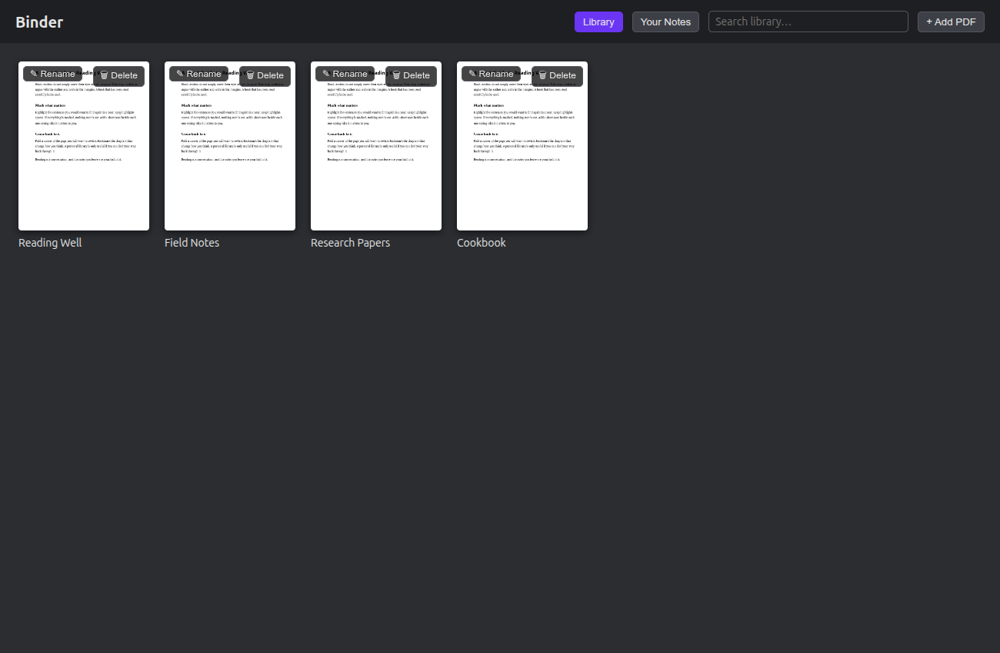
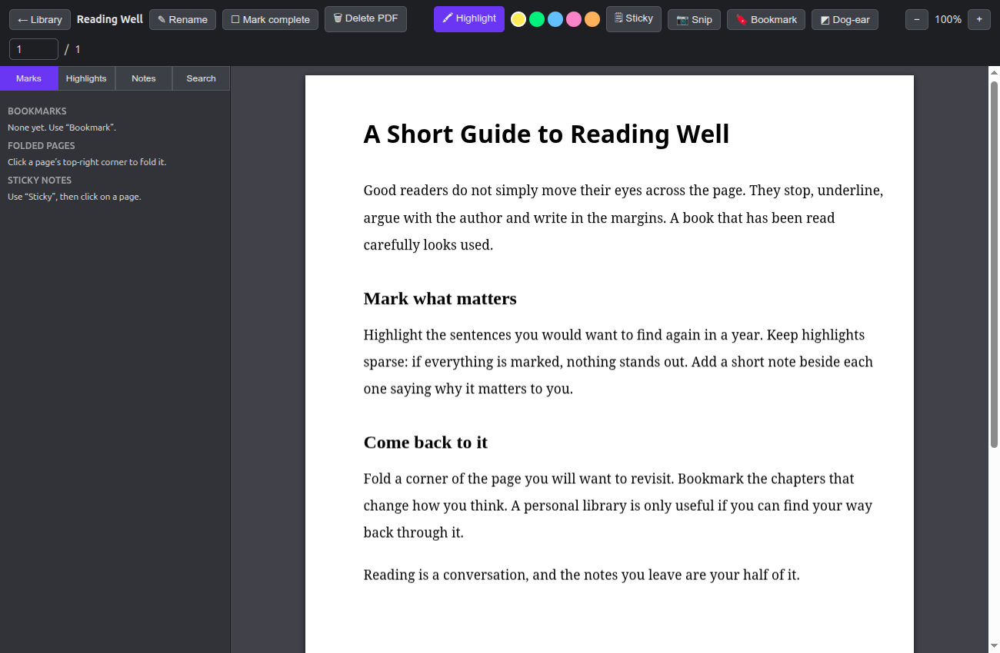

# Binder

A desktop PDF library with highlights, bookmarks, dog-ears and notes. Built with Electron and [PDF.js](https://mozilla.github.io/pdf.js/).

Your PDFs and notes are stored in plain files in `~/Binder`, independent of the app.




## Install

Download `Binder.AppImage` from the [Releases](https://github.com/rash-aad/binder/releases) page, then:

```bash
chmod +x Binder.AppImage && ./Binder.AppImage
```

## Run from source

```bash
npm install
npm start
```

## Build (Linux AppImage)

```bash
npm run dist
```

The result is `dist/Binder.AppImage`.

## License

MIT. See [LICENSE](LICENSE). PDF.js is Apache-2.0.
